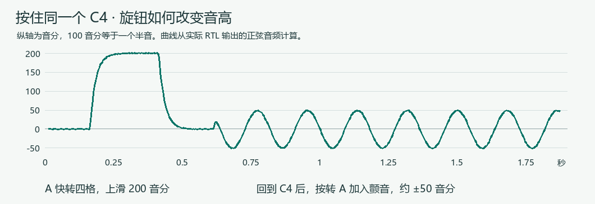

# v27 旋钮表情

J18 上的 12 键控制键盘负责演奏控制。琴键的按压强度决定力度，旋钮 A 控制正在发声的旋律音高。混响、延迟、合唱继续由原效果菜单切换。

| 操作 | 功能 |
|---|---|
| A 单独顺转 / 逆转 | 当前旋律向上 / 向下滑，每格 50 音分，最多 ±200 音分。停转约 250 ms 自动平滑回到原音，转动与回程的 95% 过渡约 63 ms。 |
| 按住 A 顺转 / 逆转 | 加深 / 减弱颤音，每格约 10 音分，从 0 到约 ±50 音分。松手后保留深度，频率约 5.5 Hz。 |
| A 单击 | 松手时全部静音，并将两种表情归零。 |
| B 单独顺转 / 逆转 | 选择下一个 / 上一个菜单项。 |
| B 单击 | 松手时执行所选菜单项。 |
| 按住 B 顺转 / 逆转 | 每格增加 / 减少约 2 个百分点。琴键页调后续触键的音量，鼓组页调鼓组音量。转动后松手只结束这次调节。 |

正弦、风琴、柔和复合及弦乐锯齿支持表情。钢琴保留 32 分量自然衰减，鼓组也保持原音。音高控制作用在每个实际发声的波表声部，因此已有和弦音程不变。Loop 回放的旋律同样响应当前旋钮，录制的数据仍是原音符和力度，旋钮轨迹不写入 Loop。HDMI 页底显示滑音和颤音设定，钢琴另标原音。Windows 转发窗口沿用其自定义布局。

## 复现

打开 `fpga/synth_display.gprj`。安装 Icarus Verilog 与 Python 的 NumPy 后，运行 `python tests/expression/verify.py` 可重放 J18 的实物按键数据、运行音频仿真、生成 C4 的试听 WAV。仿真缩短空闲时钟，按真实音频帧速率导出旋律混音。[滑音与颤音试听](tests/expression/results/sine_C4.wav) · [数字测量](tests/expression/results/measurements.json)

J18 原始鼠标报告在转动时会暂时清掉按压位，上报滚轮值并跟一帧清零，物理松手再单独上报。RTL 区分这三个报告，[重放样本](tests/expression/j18_gestures.hex)覆盖 B 按转、A 按转、A 单击、B 单击。板上协议动作 13 和 15 分别对应 A 旋转和 A 按转，参数 1 表示顺向，0 表示逆向。状态命令 12 包含当前滑音与颤音设定。

## Tang Mega 60K NEO 实测

临时下载到 SRAM 后读回 User Code `0x0000DC5C`。在功放静音时，使用同一个 C4 正弦音符，通过板上动作接口驱动表情并采集最终数字 PCM。四格上滑测得 261.623 → 293.658 Hz，自动回正后为 261.626 Hz。五格颤音测得 5.499 Hz、约 ±50.0 音分。两次相同触键的钢琴采集（无表情、同时开启满滑音和满颤音）与原音乐版 `0x0000D27F` 的 4,096 个 C4 样本逐字节一致，CRC32 均为 `819C6BC2`。

整机系统 Fmax 50.097 MHz，四组时钟 setup/hold 检查通过，保留 PR1014 通用时钟布线警告。逻辑 38,233 / 59,904，BSRAM 115 / 118，DSP 54 / 118。[码流](firmware/knob-expression.zip) · [布局结果](firmware/expression27-build.json) · [实板 PCM 与测量记录](tests/expression/results/board)

实琴联调中，板卡回报第 15 个白键 C4 按下，A 裸旋覆盖 −200 到 +200 音分，按住 A 旋转覆盖 0～50 音分。按住 B 旋转时，琴键音量从 7% 增至 9%，菜单焦点仍为 0，演奏保持开启。[J18 实际操作回读](tests/expression/results/board/live_gestures.json)
