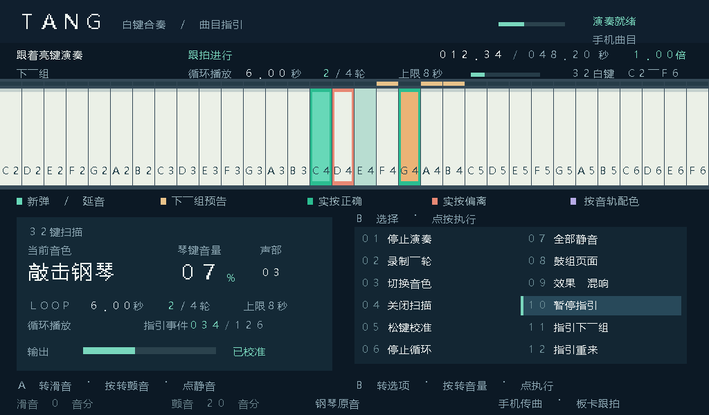

# qiansai

v31 加入手机选 PDF、蓝牙传页、板卡全屏显示与翻页。[曲谱验收步骤](FULLSCREEN-SCORE.md) · [安卓 1.2](realtime_synth/android_recorder/dist/TangRecorder-1.2.apk) · [示范谱](output/pdf/score-demo.pdf)

v30 增加手机 MIDI 传曲与板卡独立计时的屏幕演奏指引，32 个白键在上方完整一行显示。[操作与容量说明](SCREEN-GUIDE.md) · [安卓 1.1](realtime_synth/android_recorder/dist/TangRecorder-1.1.apk)

音频保留 v29 的四子帧输出。[连续 8 秒试听与工程入口](OUTPUT-HARMONICS.md)

v28 已校准板载 DAC 的耳机输出。[连续试听与校准记录](OUTPUT-CALIBRATION.md)

v27 支持 J18 旋钮滑音、颤音和按转音量。Gowin 工程入口在 `fpga/`。[手势与验证](EXPRESSION.md)

- [完整工程与使用说明](PROJECT.md)
- [Gowin FPGA 工程](fpga/synth_display.gprj)
- [上一版 32 分量钢琴完整包](TangSynth-System.zip)
